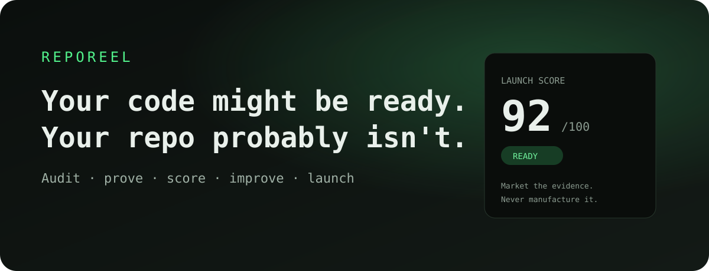
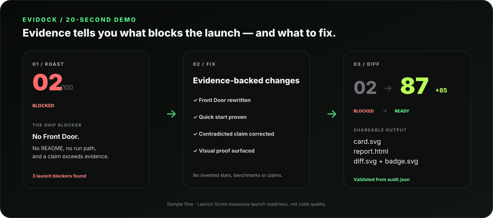
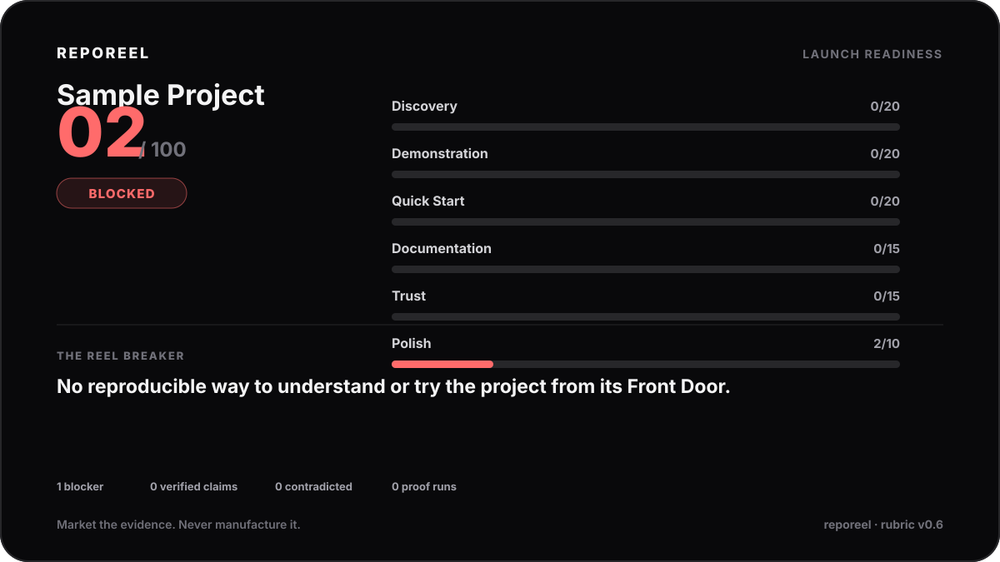
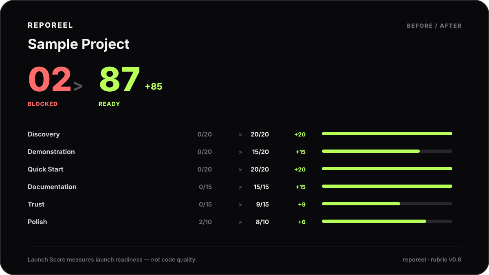

<p align="center">
  
</p>

# Evidock — evidence before you ship

<p align="center">
  <a href="https://github.com/davijardimn/evidock/stargazers"></a>
  <a href="https://github.com/davijardimn/evidock/actions/workflows/validate.yml"></a>
  <a href="LICENSE"></a>
  
</p>

Evidock turns Claude — or any agent that supports the Agent Skills format — into an **evidence-first launch reviewer for software repositories**. Give it a local repository or GitHub URL and it tells you why a stranger may bounce, checks what the README claims, proves important workflows when safe, scores launch readiness with an auditable rubric, fixes launch-surface problems, and renders shareable before/after artifacts.

> **Market the evidence. Never manufacture it.**

## The loop

```text
GitHub URL / local repo
        ↓
      ROAST
        ↓
   Launch Score
        ↓
       FIX
        ↓
      VERIFY
        ↓
     RE-AUDIT
        ↓
   DIFF + BADGE
        ↓
      SHARE
```

Evidock is deliberately not a generic code reviewer. It asks a narrower question: **is this repository ready to be understood, trusted, tried, and shared?**

<p align="center"></p>

## Try it in 30 seconds

### Claude Code

```text
/plugin marketplace add davijardimn/evidock
/plugin install evidock@evidock
```

Then:

```text
Use Evidock to roast this repository.
Use Proof Mode where it is safe and useful.
Generate the card, report and badge too.
```

Or audit a URL:

```text
Use Evidock to roast https://github.com/owner/repo
```

URL-only inspection is read-only/static evidence. Evidock does **not** pretend that a remote repository was executed.

## What it catches

| Problem | Evidock response |
| --- | --- |
| The product only makes sense after reading source | **Front Door audit** tests what a stranger can understand first |
| README promises more than the code supports | **Claim Verification** → VERIFIED / INFERRED / UNKNOWN / CONTRADICTED |
| Static inspection is not enough | **Proof Mode** runs small safe experiments and records scope + limitations |
| You only have a GitHub URL | **URL Roast** gathers bounded read-only repository evidence |
| The score feels arbitrary | **Deterministic Launch Score** maps every point to PASS / FAIL / N_A / UNKNOWN |
| You know what is wrong but not what to change | **Fix Mode** patches launch surfaces, verifies, re-audits, and diffs |
| The audit is hard to share | **Validated artifacts** generate card/report/diff/badge from structured evidence |

## Launch Score

Launch Score measures **repository launch readiness**, not code quality, security, or product completeness.

```text
Discovery        20
Demonstration    20
Quick Start      20
Documentation    15
Trust            15
Polish           10
                ───
                100
```

Each criterion is `PASS`, `FAIL`, `N_A` or `UNKNOWN`. Only `PASS` earns points. Launch Status is separate: `READY`, `CAUTION`, `BLOCKED`, or `UNKNOWN`.

The stable audit/rubric schema remains v0.6 in Evidock v0.9.0 so compatible historical audits can still be compared.

## Evidence model

Evidock separates facts agents often blur:

```text
Can the agent understand the source?      ≠ Can a visitor understand the repo?
A command is documented                   ≠ The command was proven to work
A remote GitHub URL was inspected         ≠ The project was executed
The software may be good                  ≠ The repository is launch-ready
A criterion is not applicable             ≠ The criterion passed
A prettier README exists                  ≠ The evidence improved
```

Evidence states are `VERIFIED`, `INFERRED`, `UNKNOWN`, and `CONTRADICTED`. Secrets, passwords, tokens, and unnecessary personal data are redacted from shareable output.

## GitHub URL Roast

When a native repository connector is unavailable, the bundled standard-library collector can gather bounded evidence:

```bash
python skills/evidock/scripts/inspect_github.py \
  --repo https://github.com/owner/repo \
  --output .evidock/github-evidence.json
```

It records repository metadata, resolved ref/commit, a bounded tree summary, selected Front Door files, workflow metadata, release metadata, and limitations. An already-configured `GITHUB_TOKEN` may be used for private repositories; the token is never emitted.

## Fix Mode

```text
before.audit.json
      ↓
fix plan mapped to evidence
      ↓
minimal launch-surface patch
      ↓
verification
      ↓
after.audit.json
      ↓
diff.svg
```

Fix Mode cannot raise the score by relaxing criteria, hiding evidence, converting failures to `N_A`, or inventing features/proof. If a public claim is contradicted because a feature does not exist, the default launch fix is to make the claim truthful.

## Artifacts

A roast follows a recognizable structure:

```text
EVIDOCK / ROAST
SCOPE
LAUNCH READINESS
10-SECOND TEST
THE SHIP BLOCKER
CLAIM VERIFICATION
PROOF MODE
LAUNCH BLOCKERS
SCORECARD
IF THIS WERE MY REPO
```

<p align="center"></p>
<p align="center"></p>
<p align="center"></p>

Typical output:

```text
.evidock/
├── evidence.json
├── github-evidence.json
├── audit.json
├── card.svg
├── report.html
├── badge.svg
├── badge.md
├── before.audit.json
├── after.audit.json
└── diff.svg
```

The badge is a launch-readiness snapshot, not a certification.

## Install manually

```bash
git clone https://github.com/davijardimn/evidock.git
cp -r evidock/skills/evidock ~/.claude/skills/evidock
```

For Claude.ai / Claude Desktop:

```bash
python tools/package_skill.py
```

Upload `dist/evidock.zip`. The ZIP contains `evidock/SKILL.md` at its root.

## Agent-facing tools

All bundled tools use Python's standard library only:

```bash
python skills/evidock/scripts/inspect_repo.py --root . --output .evidock/evidence.json
python skills/evidock/scripts/inspect_github.py --repo https://github.com/owner/repo --output .evidock/github-evidence.json
python skills/evidock/scripts/search_patterns.py --query "broken readme"
python skills/evidock/scripts/score_audit.py --audit .evidock/audit.json
python skills/evidock/scripts/validate_audit.py --audit .evidock/audit.json
python skills/evidock/scripts/render_card.py --audit .evidock/audit.json --output .evidock/card.svg
python skills/evidock/scripts/render_report.py --audit .evidock/audit.json --output .evidock/report.html
python skills/evidock/scripts/render_badge.py --audit .evidock/audit.json --output .evidock/badge.svg --markdown-output .evidock/badge.md
```

## What's inside

```text
.claude-plugin/                 Claude Code marketplace/plugin manifests
.github/workflows/             cross-platform validation + packaging
skills/evidock/
├── SKILL.md                    operating contract and workflow
├── references/                 evidence, scope, proof, fix, badge contracts
├── scripts/                    dependency-free deterministic helpers
├── assets/patterns.json        32 recurring launch anti-patterns
└── templates/                  structured audit template
evals/                          behavior-contract eval cases
tests/                          repository/tooling tests
tools/                          smoke/eval/package tooling
```

## Tests & evals

```bash
python -m unittest discover -s tests -v
python tools/smoke_test.py
python tools/lint_evals.py
```

CI runs on Linux, Windows and macOS with Python 3.9 and the latest available Python. The eval suite checks scope discipline, URL Roast, Fix Mode score-gaming resistance, badge integrity, redaction, `N_A != PASS`, runtime-proof limits, claim verification, and generic code-review drift.

## Why Evidock is not a README generator

A README generator can make weak evidence sound polished. Evidock does the opposite: establish scope, inspect the Front Door, classify claims, prove consequential workflows when safe, record limitations, compute points from explicit states, fix evidence-supported launch surfaces, then package/share the result.

It must never manufacture stars, users, testimonials, benchmarks, compatibility, production readiness, security properties, or feature completeness. Missing evidence becomes `UNKNOWN`, not marketing.

## Contributing

See [CONTRIBUTING.md](CONTRIBUTING.md) and [SECURITY.md](SECURITY.md).

## License

MIT — see [LICENSE](LICENSE).
