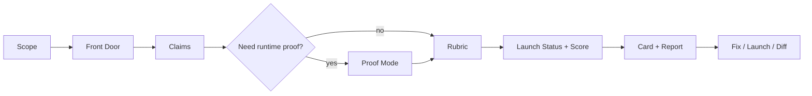

<p align="center">
  
</p>

# RepoReel — repository launch audits for Claude & AI agents

<p align="center">
  <a href="https://github.com/davijardimn/reporeel/stargazers"></a>
  <a href="https://github.com/davijardimn/reporeel/releases"></a>
  <a href="LICENSE"></a>
</p>

RepoReel turns Claude — or any agent that supports the Agent Skills format — into an **evidence-first launch reviewer for software repositories**. It inspects the Front Door, verifies public claims, safely proves important workflows, calculates an auditable Launch Score, and renders shareable artifacts before you put a project in front of GitHub, Hacker News, Reddit or users.

- **Front Door audit** — can a stranger understand what this is, who it is for, why it matters, and how to try it without spelunking through source?
- **Claim Verification + Proof Mode** — separates documentation from evidence and can run small, non-destructive experiments when static inspection is not enough.
- **Deterministic Launch Score** — every point maps to a versioned `PASS / FAIL / N_A / UNKNOWN` criterion; `N_A` never earns free credit.
- **Shareable output** — `audit.json`, score card, HTML report and before → after diff, all derived from validated structured data.
- **Launch Pattern Library** — a searchable library of recurring repository-launch anti-patterns and evidence-backed remediation paths.

> **Market the evidence. Never manufacture it.**

**Contents:** [How it works](#how-it-works) · [Install](#install) · [Example](#example) · [Use](#use) · [What’s inside](#whats-inside) · [Pattern library](#launch-pattern-library) · [Tests & evals](#tests--evals)

---

## How it works



RepoReel deliberately separates four things that are easy to blur:

```text
Can the agent understand the source?      ≠ Can a visitor understand the repo?
A command is documented                   ≠ The command was proven to work
The software may be good                  ≠ The repository is launch-ready
A criterion is not applicable             ≠ The criterion passed
```

A `roast` ends with a diagnosis, not generic code-review noise. A `proof` records exactly what environment was exercised and what the result does **not** prove.

---

## Install

### Claude Code — plugin marketplace

Add the RepoReel repository as a Claude Code plugin marketplace, then install the plugin:

```text
/plugin marketplace add davijardimn/reporeel
/plugin install reporeel@reporeel
```

The repository already includes `.claude-plugin/plugin.json` and `marketplace.json` for Claude Code installation.

### Claude Code — manual

```bash
git clone https://github.com/davijardimn/reporeel.git
cp -r reporeel/skills/reporeel ~/.claude/skills/reporeel
# or per-project:
cp -r reporeel/skills/reporeel .claude/skills/reporeel
```

### Claude.ai / Claude Desktop

Build the uploadable Skill ZIP:

```bash
python tools/package_skill.py
```

Upload `dist/reporeel.zip` under Claude's Skills settings. The ZIP contains `reporeel/SKILL.md` at its root.

### Codex, Gemini CLI, Cursor and other agents

RepoReel uses the open Agent Skills layout: a directory containing `SKILL.md`, plain Markdown references, JSON assets and dependency-free Python tools. Copy `skills/reporeel/` into the skills directory supported by your agent.

---

## Example

Ask:

```text
Use RepoReel to roast this repository.
Use Proof Mode where it is safe and useful.
Generate the card and report too.
```

A roast follows a recognizable structure:

```text
REPOREEL / ROAST
SCOPE
LAUNCH READINESS
10-SECOND TEST
THE REEL BREAKER
CLAIM VERIFICATION
PROOF MODE
LAUNCH BLOCKERS
SCORECARD
IF THIS WERE MY REPO
```

The visual output is generated from validated `audit.json`, not re-scored by the renderer:

<p align="center"></p>

After improvements, `diff` makes the change visible:

<p align="center"></p>

---

## Use

Just ask naturally — the Skill is designed to trigger on repository launch/readiness work even if the user never says “RepoReel”.

> “Why would someone open this repo and leave without starring it?”  
> “Verify the claims in my README.”  
> “Prove the quick start works, but don't change the source.”  
> “Fix my Front Door and re-audit it.”  
> “Prepare HN, Reddit and X launch copy from verified evidence.”  
> “Compare the before and after RepoReel audits.”

Modes: `audit` · `roast` · `verify` · `proof` · `fix` · `readme` · `launch` · `diff` · `ship`.

### Agent-facing tools

All current tools use Python's standard library only:

```bash
python skills/reporeel/scripts/inspect_repo.py --root . --output .reporeel/evidence.json
python skills/reporeel/scripts/search_patterns.py --query "broken readme"
python skills/reporeel/scripts/score_audit.py --audit .reporeel/audit.json
python skills/reporeel/scripts/validate_audit.py --audit .reporeel/audit.json
python skills/reporeel/scripts/render_card.py --audit .reporeel/audit.json --output .reporeel/card.svg
python skills/reporeel/scripts/render_report.py --audit .reporeel/audit.json --output .reporeel/report.html
python skills/reporeel/scripts/verify_artifacts.py --audit .reporeel/audit.json --card .reporeel/card.svg --report .reporeel/report.html
```

---

## What's inside

```text
.claude-plugin/                 Claude Code marketplace/plugin manifests
.github/workflows/             cross-platform validation + packaging
skills/reporeel/
├── SKILL.md                    operating contract and workflow
├── references/                 loaded on demand
│   ├── front-door.md           what counts before source spelunking
│   ├── evidence.md             VERIFIED / INFERRED / UNKNOWN / CONTRADICTED
│   ├── proof-mode.md           safe runtime proof protocol
│   ├── audit-rubric.md         deterministic 100-point rubric
│   ├── launch-status.md        READY / CAUTION / BLOCKED / UNKNOWN
│   ├── redaction.md            share findings without leaking secrets/PII
│   └── pattern-library.md      how to use recurring launch anti-patterns
├── scripts/
│   ├── inspect_repo.py         static evidence collector
│   ├── search_patterns.py      query the launch-pattern library
│   ├── score_audit.py          recompute scores from criterion states
│   ├── validate_audit.py       enforce the audit contract
│   ├── render_card.py          audit.json → shareable SVG
│   ├── render_report.py        audit.json → standalone HTML
│   ├── render_diff.py          before/after → SVG
│   └── verify_artifacts.py     structural integrity checks
├── assets/patterns.json        curated launch anti-pattern library
└── templates/                  structured audit template
evals/                          behavior-contract eval cases
tests/                          repository/tooling tests
tools/
├── smoke_test.py               run scripts the way an agent runs them
├── lint_evals.py               validate eval suite
└── package_skill.py            build dist/reporeel.zip
```

---

## Launch Pattern Library

RepoReel currently ships **32 recurring launch patterns** covering discovery, demonstration, quick start, documentation, trust, polish and audit-method failures. Examples include `front-door-void`, `claim-exceeds-code`, `platform-trap`, `proof-scope-overreach`, `na-as-pass` and `code-review-drift`.

Search it locally:

```bash
python skills/reporeel/scripts/search_patterns.py --category trust
python skills/reporeel/scripts/search_patterns.py --severity HIGH
python skills/reporeel/scripts/search_patterns.py --query "runtime support"
```

Patterns never replace direct evidence or the rubric. They help the agent name and remediate what it has already observed.

---

## Tests & evals

Run the unit suite and end-to-end smoke test:

```bash
python -m unittest discover -s tests -v
python tools/smoke_test.py
python tools/lint_evals.py
```

CI is designed to run on Linux, Windows and macOS so console/path assumptions do not silently make the Skill platform-specific.

The `evals/` suite tests the behavioral contract: implicit triggering, scope discipline, redaction, `N_A != PASS`, runtime proof limits, claim verification, and preventing generic code-review drift. It does **not** pretend to be a model benchmark.

---

## Why RepoReel is not a README generator

A README generator can make weak evidence sound polished. RepoReel does the opposite: it establishes scope, checks the Front Door, classifies claims, proves consequential workflows when safe, records limitations, computes points from explicit states, and only then helps improve presentation or launch copy.

It must never manufacture stars, users, testimonials, benchmarks, compatibility, production readiness, security properties or feature completeness. Missing evidence becomes `UNKNOWN`, not marketing.

## Contributing

Contributions are welcome: sharper rubric wording, new launch patterns, platform fixes, eval cases, artifact improvements and reproducible bug reports. See [CONTRIBUTING.md](CONTRIBUTING.md) and [SECURITY.md](SECURITY.md).

## License

MIT — see [LICENSE](LICENSE).
