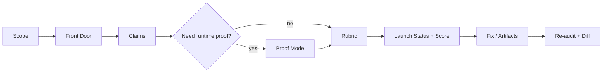

<p align="center">
  
</p>

# RepoReel — repository launch audits for Claude & AI agents

<p align="center">
  <a href="https://github.com/davijardimn/reporeel/stargazers"></a>
  <a href="https://github.com/davijardimn/reporeel/actions/workflows/validate.yml"></a>
  <a href="LICENSE"></a>
  
</p>

RepoReel turns Claude — or any agent that supports the Agent Skills format — into an **evidence-first launch reviewer for software repositories**. It tells you why a stranger would bounce, checks what your README claims, safely proves important workflows when local execution is available, scores launch readiness with an auditable rubric, fixes launch-surface problems, and renders shareable before/after artifacts.

> **Market the evidence. Never manufacture it.**

## v0.8 closes the loop

```text
GitHub URL / local repo
        ↓
      ROAST
        ↓
   Launch Score
        ↓
       FIX
        ↓
      VERIFY
        ↓
     RE-AUDIT
        ↓
   DIFF + BADGE
        ↓
      SHARE
```

Three additions make that loop practical:

- **GitHub URL Roast** — point RepoReel at `https://github.com/owner/repo`; remote inspection stays read-only and is explicitly labeled static evidence.
- **Fix Mode** — baseline → fix plan → minimal patch → verification → re-audit → diff, with explicit protection against score gaming.
- **RepoReel Badge** — render a static SVG + ready-to-paste Markdown directly from validated `audit.json`.

<p align="center">
  
</p>

The badge is a launch-readiness snapshot — not a code-quality, security, production-readiness or compatibility certification.

## Try it in 30 seconds

### 1. Install in Claude Code

```text
/plugin marketplace add davijardimn/reporeel
/plugin install reporeel@reporeel
```

### 2. Roast a repository

Local repo:

```text
Use RepoReel to roast this repository.
Use Proof Mode where it is safe and useful.
Generate the card, report and badge too.
```

Or give it a GitHub URL:

```text
Use RepoReel to roast https://github.com/owner/repo
```

For a URL-only audit, RepoReel keeps the scope honest: remote inspection can prove repository/documentation facts, but it does not pretend that install/run behavior was executed.

<p align="center">
  
</p>

The score above is **launch readiness**, not code quality. A brilliant project can score badly when its repository does not explain, prove or package the product well.

## What RepoReel catches

| Problem | What RepoReel does |
| --- | --- |
| The product only makes sense after reading source | **Front Door audit** tests what a stranger understands before source spelunking |
| README promises more than the code delivers | **Claim Verification** classifies claims as VERIFIED / INFERRED / UNKNOWN / CONTRADICTED |
| Static inspection is not enough | **Proof Mode** runs small, safe experiments and records scope + limitations |
| You only have a GitHub URL | **URL Roast** gathers bounded, read-only repository evidence without calling it runtime proof |
| “AI score” feels arbitrary | **Deterministic Launch Score** maps every point to PASS / FAIL / N_A / UNKNOWN; `N_A` earns 0 |
| You know what is wrong but not how to fix it | **Fix Mode** patches launch surfaces, verifies them, re-audits, and produces a before/after diff |
| The same launch mistakes repeat across repos | **32-pattern library** names recurring failures such as `front-door-void`, `claim-exceeds-code`, `platform-trap` and `na-as-pass` |
| The audit is hard to share | **Validated artifacts** generate `card.svg`, `report.html`, `diff.svg`, `badge.svg` and `badge.md` from structured evidence |

**Contents:** [Install](#install) · [How it works](#how-it-works) · [URL Roast](#github-url-roast) · [Fix Mode](#fix-mode) · [Artifacts](#artifacts) · [Use](#use) · [What’s inside](#whats-inside) · [Tests & evals](#tests--evals)

---

## Install

### Claude Code — plugin marketplace (recommended)

```text
/plugin marketplace add davijardimn/reporeel
/plugin install reporeel@reporeel
```

### Claude Code — manual

```bash
git clone https://github.com/davijardimn/reporeel.git
cp -r reporeel/skills/reporeel ~/.claude/skills/reporeel
# or per-project:
cp -r reporeel/skills/reporeel .claude/skills/reporeel
```

### Claude.ai / Claude Desktop

Build the uploadable Skill ZIP:

```bash
python tools/package_skill.py
```

Upload `dist/reporeel.zip` under Claude's Skills settings. The ZIP contains `reporeel/SKILL.md` at its root. A packaged ZIP is also intended to be attached to GitHub Releases.

### Codex, Gemini CLI, Cursor and other agents

RepoReel uses the open Agent Skills layout: a directory containing `SKILL.md`, plain Markdown references, JSON assets and dependency-free Python tools. Copy `skills/reporeel/` into the skills directory supported by your agent.

---

## How it works



RepoReel deliberately separates things that agents often blur:

```text
Can the agent understand the source?      ≠ Can a visitor understand the repo?
A command is documented                   ≠ The command was proven to work
A remote GitHub URL was inspected         ≠ The project was executed
The software may be good                  ≠ The repository is launch-ready
A criterion is not applicable             ≠ The criterion passed
A prettier README exists                  ≠ The evidence improved
```

### Evidence states

- `VERIFIED` — directly supported by repository evidence or scoped proof.
- `INFERRED` — strongly suggested, but not directly proven.
- `UNKNOWN` — insufficient evidence.
- `CONTRADICTED` — evidence conflicts with the public claim.

Secrets, passwords and unnecessary personal data are redacted from shareable reports. RepoReel proves the finding without republishing the sensitive value.

### Launch Score

The stable rubric totals 100 points:

```text
Discovery        20
Demonstration    20
Quick Start      20
Documentation    15
Trust            15
Polish           10
                ───
                100
```

Each criterion is `PASS`, `FAIL`, `N_A` or `UNKNOWN`. Only `PASS` earns points. The audit/rubric schema remains v0.6 in RepoReel v0.8.0 so compatible historical audits can still be diffed.

---

## GitHub URL Roast

When the environment has a native repository connector, RepoReel should prefer it. The bundled standard-library collector provides a deterministic fallback:

```bash
python skills/reporeel/scripts/inspect_github.py \
  --repo https://github.com/davijardimn/reporeel \
  --output .reporeel/github-evidence.json
```

It collects repository metadata, resolved ref/commit, a bounded tree summary, selected Front Door files, workflow metadata and recent release metadata.

For private repositories, an already-configured `GITHUB_TOKEN` can be used. RepoReel never needs the token pasted into the prompt and never writes it into the evidence output.

URL Roast is intentionally **static and read-only**. Runtime claims remain scoped accordingly.

---

## Fix Mode

Ask:

```text
Use RepoReel to fix the launch blockers, verify the changes, re-audit, and generate the diff.
```

RepoReel then follows:

```text
before.audit.json
      ↓
fix plan mapped to evidence
      ↓
minimal launch-surface patch
      ↓
verification
      ↓
after.audit.json
      ↓
diff.svg
```

Fix Mode prefers README/docs/quick-start/navigation/demo-reference/repository-presentation fixes. It does not silently implement missing product features just to raise the score.

If a claim is contradicted because the feature does not exist, the default launch fix is to make the public claim truthful. Product implementation is a separate task unless explicitly requested.

---

## Artifacts

A roast follows a recognizable structure:

```text
REPOREEL / ROAST
SCOPE
LAUNCH READINESS
10-SECOND TEST
THE REEL BREAKER
CLAIM VERIFICATION
PROOF MODE
LAUNCH BLOCKERS
SCORECARD
IF THIS WERE MY REPO
```

The visual output is generated from validated `audit.json`; renderers do not invent or re-score anything:

<p align="center"></p>

After improvements, `diff` makes the change visible:

<p align="center"></p>

Typical output:

```text
.reporeel/
├── evidence.json
├── github-evidence.json
├── audit.json
├── card.svg
├── report.html
├── badge.svg
├── badge.md
├── before.audit.json
├── after.audit.json
└── diff.svg
```

Render the badge directly:

```bash
python skills/reporeel/scripts/render_badge.py \
  --audit .reporeel/audit.json \
  --output .reporeel/badge.svg \
  --markdown-output .reporeel/badge.md
```

The generated Markdown links back to RepoReel by default, making discovery opt-in and transparent rather than automatic/spammy.

---

## Use

Ask naturally — the Skill is designed to trigger on repository launch/readiness work even if the user never says “RepoReel”.

> “Roast https://github.com/owner/repo before I share it.”  
> “Why would someone open this repo and leave without starring it?”  
> “Verify the claims in my README.”  
> “Prove the quick start works, but don't change the source.”  
> “Fix my Front Door, verify the patch and show me the before/after.”  
> “Generate a RepoReel badge from this audit.”  
> “Prepare Reddit and X launch copy from verified evidence.”

Modes: `audit` · `roast` · `verify` · `proof` · `fix` · `readme` · `launch` · `diff` · `ship`.

### Agent-facing tools

All bundled tools use Python's standard library only:

```bash
python skills/reporeel/scripts/inspect_repo.py --root . --output .reporeel/evidence.json
python skills/reporeel/scripts/inspect_github.py --repo https://github.com/owner/repo --output .reporeel/github-evidence.json
python skills/reporeel/scripts/search_patterns.py --query "broken readme"
python skills/reporeel/scripts/score_audit.py --audit .reporeel/audit.json
python skills/reporeel/scripts/validate_audit.py --audit .reporeel/audit.json
python skills/reporeel/scripts/render_card.py --audit .reporeel/audit.json --output .reporeel/card.svg
python skills/reporeel/scripts/render_report.py --audit .reporeel/audit.json --output .reporeel/report.html
python skills/reporeel/scripts/render_badge.py --audit .reporeel/audit.json --output .reporeel/badge.svg --markdown-output .reporeel/badge.md
python skills/reporeel/scripts/verify_artifacts.py --audit .reporeel/audit.json --card .reporeel/card.svg --report .reporeel/report.html
```

---

## What's inside

```text
.claude-plugin/                 Claude Code marketplace/plugin manifests
.github/workflows/             cross-platform validation + packaging
skills/reporeel/
├── SKILL.md                    operating contract and workflow
├── references/                 loaded on demand
│   ├── github-url.md           remote URL evidence boundary
│   ├── fix-mode.md             evidence-preserving repair loop
│   ├── badge.md                shareable badge integrity contract
│   ├── front-door.md
│   ├── evidence.md
│   ├── proof-mode.md
│   ├── audit-rubric.md
│   ├── launch-status.md
│   ├── redaction.md
│   └── pattern-library.md
├── scripts/
│   ├── inspect_repo.py         local static evidence collector
│   ├── inspect_github.py       GitHub URL evidence collector
│   ├── search_patterns.py
│   ├── score_audit.py
│   ├── validate_audit.py
│   ├── render_card.py
│   ├── render_report.py
│   ├── render_badge.py         audit.json → README badge + Markdown
│   ├── render_diff.py
│   └── verify_artifacts.py
├── assets/patterns.json        curated launch anti-pattern library
└── templates/                  structured audit template
evals/                          behavior-contract eval cases
tests/                          repository/tooling tests
tools/                          smoke/eval/package tooling
```

---

## Launch Pattern Library

RepoReel ships **32 recurring launch patterns** covering discovery, demonstration, quick start, documentation, trust, polish and audit-method failures. Examples include `front-door-void`, `claim-exceeds-code`, `platform-trap`, `proof-scope-overreach`, `na-as-pass` and `code-review-drift`.

Search it locally:

```bash
python skills/reporeel/scripts/search_patterns.py --category trust
python skills/reporeel/scripts/search_patterns.py --severity HIGH
python skills/reporeel/scripts/search_patterns.py --query "runtime support"
```

Patterns never replace direct evidence or the rubric.

---

## Tests & evals

RepoReel ships unit/integration tests, an end-to-end smoke test and a behavioral eval suite. CI runs on Linux, Windows and macOS with Python 3.9 and the latest available Python.

```bash
python -m unittest discover -s tests -v
python tools/smoke_test.py
python tools/lint_evals.py
```

The eval suite covers implicit triggering, URL-scope discipline, Fix Mode score-gaming resistance, badge integrity, redaction, `N_A != PASS`, runtime-proof limits, claim verification and preventing generic code-review drift. It is a behavioral contract, not a model benchmark.

---

## Why RepoReel is not a README generator

A README generator can make weak evidence sound polished. RepoReel does the opposite: it establishes scope, checks the Front Door, classifies claims, proves consequential workflows when safe, records limitations, computes points from explicit states, fixes only evidence-supported launch surfaces, and **only then** helps package/share the result.

It must never manufacture stars, users, testimonials, benchmarks, compatibility, production readiness, security properties or feature completeness. Missing evidence becomes `UNKNOWN`, not marketing.

## Contributing

Contributions are welcome: sharper rubric wording, new launch patterns, platform fixes, eval cases, artifact improvements and reproducible bug reports. See [CONTRIBUTING.md](CONTRIBUTING.md) and [SECURITY.md](SECURITY.md).

## License

MIT — see [LICENSE](LICENSE).
